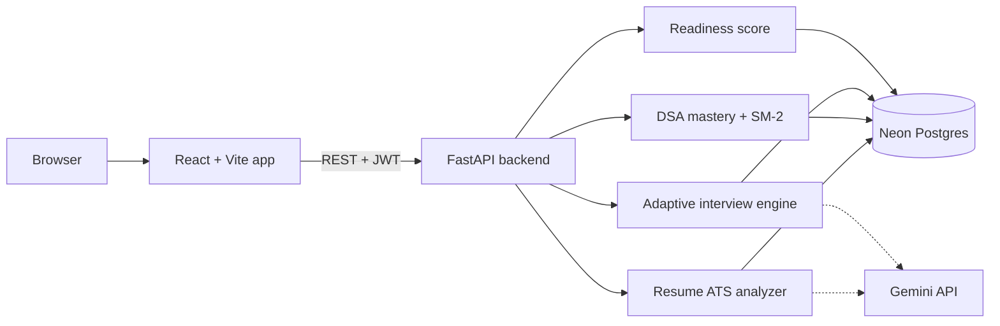
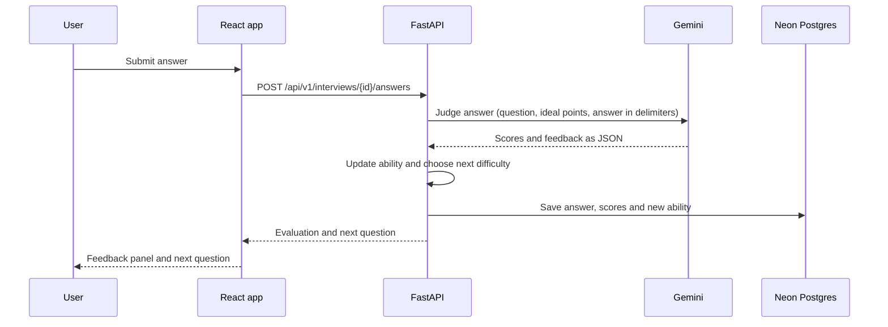

<div align="center">

# Placement Copilot

**An AI-assisted placement-prep platform: resume ATS scoring, DSA mastery tracking, adaptive mock interviews, and one explainable Readiness Score.**


Live demo: _coming soon_ · [API reference](docs/API.md) · [Architecture](docs/ARCHITECTURE.md) · [Design decisions](docs/DECISIONS.md) · [Frontend tour](docs/FRONTEND_TOUR.md)

</div>


## Why I built it

Placement prep is scattered across resume checkers, problem trackers and mock-interview tools, and none of them tell you what to do next. Placement Copilot connects the three in one loop and turns them into a single score, together with the specific actions that would raise it. It is also my attempt to build a full-stack product where every number on screen comes from an algorithm I can explain.

## Screenshots

| Dashboard | DSA Tracker |
|---|---|
| 

 | 


 |
| **Resume ATS Analyzer** | **Adaptive Mock Interview** |
| 
 |

 | 

 |
| **Interview report** | **Sign in** |
|  |

 | 

 |

## Features

- **Resume ATS Analyzer.** Upload a PDF or DOCX, or paste text, and compare it with a job description. Skills are extracted against a taxonomy of about 380 terms with fuzzy matching. Four sub-scores (keyword, TF-IDF, semantic, content quality), matched skills with evidence, missing skills ranked by importance, and rewrite suggestions that reuse your own bullets and never invent experience.
- **DSA Tracker.** Log problems from a catalog of 140+ interview problems or add your own. Per-topic mastery with time decay, SM-2 spaced-repetition reviews, five recommended problems with a reason each, weak-area bars and a 7-day activity chart.
- **Adaptive Mock Interview.** Question difficulty follows a live ability estimate. An LLM judge scores each answer against a fixed rubric, one follow-up per question is allowed, and a final report shows the ability trajectory.
- **Dashboard.** Readiness gauge with weekly delta, component breakdown, the three actions that would raise the score most, a daily focus task and an activity feed. New users get an onboarding checklist instead of empty charts.
- **Profile.** Edit details, change password, export all data as JSON, or hard-delete the account.

## Architecture



What happens when a user submits an interview answer:



More diagrams (database ER, auth and token refresh) are in [docs/ARCHITECTURE.md](docs/ARCHITECTURE.md).

## How the AI works

Design rule: **algorithms score, LLMs explain.** Scores are deterministic and reproducible. The LLM writes questions, feedback and rewrite suggestions, always as schema-validated JSON, and never changes a score.

| Feature | Method | Details |
|---|---|---|
| Resume match | Hybrid scoring | `overall = 0.40·keyword + 0.25·semantic + 0.15·TF-IDF + 0.20·quality`. Semantic similarity uses Gemini embeddings. If embeddings are unavailable the semantic term is dropped, the weights are renormalised and the result is flagged as degraded. |
| DSA mastery | Time-decayed evidence | Difficulty weights 1 / 2 / 3.5, decay constant 45 days, `mastery = 1 − e^(−S / target)`. SM-2 schedules reviews. |
| Adaptive interview | Rasch (1PL) style ability model | Ability θ in [1, 5], starting at 2.5. Expected score `P = 1 / (1 + e^−(θ − b))`. Update `θ += K·(score − P)` with a decaying step. Next question targets difficulty ≈ θ + 0.3. |
| Answer judging | LLM rubric | Correctness 40%, depth 25%, structure 20%, communication 15%. The answer is isolated in delimiters and treated as untrusted data. Low temperature, schema-validated output, heuristic fallback flagged as degraded. |
| Readiness score | Weighted composite | `0.25·ATS + 0.35·DSA + 0.30·interview + 0.10·consistency`. Components with no data are excluded and the weights renormalised, and a confidence figure is shown. "Levers" are found by simulating the next best action. |

## Tech stack

| Layer | Technology |
|---|---|
| Frontend | React, Vite, JavaScript (JSX), Tailwind CSS v4, Zustand, TanStack Query, React Router, react-hook-form + Zod, Recharts |
| Backend | Python, FastAPI, Pydantic v2, SQLAlchemy 2.0 (async), Alembic, PyJWT, Argon2 |
| Database | Neon serverless PostgreSQL (pooled connection for the app, direct connection for migrations) |
| AI / ML | Gemini API (generation and embeddings), scikit-learn (TF-IDF), rapidfuzz, NumPy |
| Quality | pytest, ESLint, Ruff |

## Project structure

```text
placement-copilot/
├── backend/
│   ├── app/
│   │   ├── api/v1/       route handlers
│   │   ├── core/         config, database, security
│   │   ├── models/       SQLAlchemy models
│   │   ├── schemas/      Pydantic request/response models
│   │   ├── services/     ats, dsa, interview, readiness, llm
│   │   └── data/         skills taxonomy, DSA catalog, question bank
│   ├── alembic/          migrations
│   ├── scripts/          seed.py, seed_demo.py
│   └── tests/
├── frontend/
│   └── src/
│       ├── features/     auth, dashboard, dsa, resume, interview, profile
│       ├── components/
│       └── lib/api/
├── docs/                 API, architecture, decisions, frontend tour
└── dev.sh                starts backend and frontend together
```

## Getting started

**Prerequisites:** Python 3.12+, Node.js 20+, a free [Neon](https://neon.com) account, and a Gemini API key from [Google AI Studio](https://aistudio.google.com).

```bash
git clone https://github.com/Fb-JAYRAJ/placement-copilot.git
cd placement-copilot
```

**1. Database.** In Neon, create a project with a `dev` branch and a `test` branch. From each branch's Connect dialog copy the pooled string and the direct string, and change the start of each from `postgresql://` to `postgresql+psycopg://`.

**2. Backend.**

```bash
cd backend
python3 -m venv .venv
source .venv/bin/activate
pip install -r requirements.txt
cp .env.example .env         # then fill in the values below
alembic upgrade head         # uses DATABASE_URL_DIRECT
python scripts/seed.py       # skills, topics, problems, question bank
python scripts/seed_demo.py  # optional: demo account with sample data
cd ..
```

| Variable | Purpose |
|---|---|
| `DATABASE_URL` | Neon pooled connection string (app traffic) |
| `DATABASE_URL_DIRECT` | Neon direct connection string (migrations) |
| `TEST_DATABASE_URL` | Neon `test` branch (integration tests) |
| `GEMINI_API_KEY` | Google AI Studio key |
| `GEMINI_MODEL`, `GEMINI_EMBEDDING_MODEL` | Model names, verified at startup |
| `SECRET_KEY`, `JWT_SECRET` | Random secrets for signing |
| `CORS_ORIGINS` | Allowed frontend origins |

See `backend/.env.example` for the full list.

**3. Frontend.**

```bash
cd frontend
npm install
cd ..
```

**4. Run everything.**

```bash
./dev.sh
```

- App: http://localhost:5173
- API docs (Swagger): http://localhost:8000/docs
- Demo account, if you ran the demo seed: `demo@placementcopilot.com` / `DemoCandidate2026!`

## Running the tests

```bash
cd backend && source .venv/bin/activate && pytest -q
cd ../frontend && npm run lint && npm run build
```

Integration tests run against the Neon `test` branch, so the first request after a pause can take a second or two while the database wakes up.

## API

Interactive documentation is served at `/docs` while the backend runs. Request and response shapes for every endpoint are listed in [docs/API.md](docs/API.md).

## Security

- Passwords are hashed with Argon2.
- Short-lived access tokens, and refresh tokens that rotate on use, are stored hashed and can be revoked.
- Rate limits protect login and LLM endpoints, and each user has a daily LLM quota.
- Uploads are validated by file signature, size-limited, and only the extracted text is kept.
- Interview answers are isolated from instructions before being sent to the LLM, and model output is schema-validated.
- Secrets live in environment variables and are never committed.

## Design decisions

- **Two Neon connection strings.** The app uses the pooled endpoint for many short requests, while Alembic uses the direct endpoint because migrations need a normal session.
- **Algorithms score, LLMs explain.** Keeping scores out of the model makes them reproducible, testable and explainable.
- **No claims the data can't support.** The dashboard shows "not enough data yet" and a confidence figure instead of a fake number.
- **JavaScript on the frontend.** Chosen for clarity and speed of iteration, and recorded in [docs/DECISIONS.md](docs/DECISIONS.md).

## Limitations and roadmap

- Scanned, image-only resumes need an OCR step; text-based PDFs and DOCX files work today.
- Interviews accept written answers only. Voice input is the next planned feature.
- Planned: automatic sync of solved problems from coding platforms, a downloadable PDF report, and Google/GitHub sign-in.

## Author

**Jayraj Sawant**: [GitHub](https://github.com/Fb-JAYRAJ) · [LinkedIn](https://www.linkedin.com/in/jayraj-sawant12)

## License

MIT. See [LICENSE](LICENSE).
