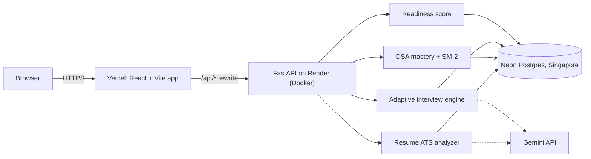
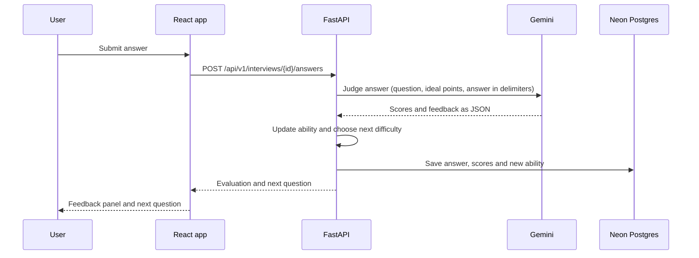

<div align="center">

# 🚀 Placement Copilot

**An AI-assisted placement-prep platform that combines resume ATS scoring, DSA mastery tracking and adaptive mock interviews into one explainable Readiness Score.**

[](https://placement-copilot-nine.vercel.app)
[](https://github.com/Fb-JAYRAJ/Placement-Copilot-/actions/workflows/ci.yml)


**[🌐 Try it live](https://placement-copilot-nine.vercel.app)** · [📚 API reference](docs/API.md) · [🏛️ Architecture](docs/ARCHITECTURE.md) · [🧭 Design decisions](docs/DECISIONS.md) · [🗺️ Frontend tour](docs/FRONTEND_TOUR.md) · [🚢 Deployment](docs/DEPLOYMENT.md)

</div>

## Table of contents

- [Try it live](#-try-it-live)
- [Screenshots](#-screenshots)
- [Why I built it](#-why-i-built-it)
- [Features](#-features)
- [Architecture](#-architecture)
- [How the AI works](#-how-the-ai-works)
- [Reliability](#-reliability)
- [Tech stack](#-tech-stack)
- [Project structure](#-project-structure)
- [Getting started](#-getting-started)
- [Running the tests](#-running-the-tests)
- [Deployment](#-deployment)
- [Security](#-security)
- [Design decisions](#-design-decisions)
- [Troubleshooting](#-troubleshooting)
- [Limitations and roadmap](#-limitations-and-roadmap)
- [Author](#-author)
- [License](#-license)

## 🌐 Try it live

| | Link |
|---|---|
| **App** | https://placement-copilot-nine.vercel.app |
| **API health check** | https://placement-copilot-morn.onrender.com/api/v1/health |

1. Open the app and choose **Create Account**. There is no shared demo login, so you sign up with your own email and a password of at least 10 characters.
2. You land on a dashboard with an onboarding checklist: upload or paste a resume, log a few DSA problems and take a mock interview. The readiness score fills in as you add data.
3. This is a portfolio project, so please avoid uploading anything sensitive. You can delete your account and all its data from **Profile** at any time.

> [!NOTE]
> The backend runs on a free hosting tier that goes to sleep when idle. If nobody has used the app for about 15 minutes, the first request can take up to about a minute. The app shows a "Waking up the server" notice while it starts, and everything is fast afterwards.

## 📸 Screenshots

<table>
  <tr>
    <td width="50%" align="center">
      <b>📊 Dashboard</b><br />
      <sub>Readiness score, levers and activity feed</sub><br />
      
    </td>
    <td width="50%" align="center">
      <b>🧮 DSA Tracker</b><br />
      <sub>Mastery bars, recommendations and review schedule</sub><br />
      
    </td>
  </tr>
  <tr>
    <td width="50%" align="center">
      <b>📄 Resume ATS Analyzer</b><br />
      <sub>Match score, matched and missing skills, rewrite suggestions</sub><br />
      
    </td>
    <td width="50%" align="center">
      <b>🎤 Adaptive Mock Interview</b><br />
      <sub>Live difficulty badge and rubric-based feedback</sub><br />
      
    </td>
  </tr>
  <tr>
    <td colspan="2" align="center">
      <b>📈 Interview report</b><br />
      <sub>Ability trajectory and per-question breakdown</sub><br />
      
    </td>
  </tr>
</table>

## 💡 Why I built it

Placement prep is scattered across resume checkers, problem trackers and mock-interview tools, and none of them tell you what to do next. Placement Copilot connects all three in one loop and turns them into a single score, along with the specific actions that would raise it. It is also my attempt to build a full-stack product where every number on screen comes from an algorithm I can explain.

## ✨ Features

- 📄 **Resume ATS Analyzer.** Upload a PDF or DOCX, or paste text, and compare it with a job description. Skills are matched against a taxonomy of about 380 terms, with fuzzy matching for variants. You get four sub-scores (keyword, TF-IDF, semantic and content quality), matched skills with evidence, missing skills ranked by importance, and rewrite suggestions that reuse your own bullets and never invent experience.
- 🧮 **DSA Tracker.** Log problems from a catalog of 142 interview problems across 20 topics, or add your own. Mastery is tracked per topic with time decay, SM-2 spaced repetition schedules your reviews, and the app recommends five problems with a reason for each, alongside weak-area bars and a 7-day activity chart.
- 🎤 **Adaptive Mock Interview.** Question difficulty follows a live ability estimate, drawn from a bank of 150 questions. An LLM judge scores each answer against a fixed rubric, one follow-up is allowed per question, and a final report shows your ability trajectory.
- 📊 **Dashboard.** A readiness gauge with weekly change, a component breakdown, the three actions that would raise your score most, a daily focus task and an activity feed. New users get an onboarding checklist instead of empty charts.
- 👤 **Profile.** Edit your details, change your password, export all your data as JSON, or hard-delete your account.

## 🏗️ Architecture

How the deployed system fits together:



What happens when a user submits an interview answer:



More diagrams (database ER, auth and token refresh) are in [docs/ARCHITECTURE.md](docs/ARCHITECTURE.md).

## 🧠 How the AI works

Design rule: **algorithms score, LLMs explain.** Scores are deterministic and reproducible. The LLM writes questions, feedback and rewrite suggestions, always as schema-validated JSON, and never changes a score.

| Feature | Method | Details |
|---|---|---|
| Resume match | Hybrid scoring | `overall = 0.40·keyword + 0.25·semantic + 0.15·TF-IDF + 0.20·quality`. Semantic similarity uses Gemini embeddings. If embeddings are unavailable, the semantic term is dropped, the weights are renormalized and the result is flagged as degraded. |
| DSA mastery | Time-decayed evidence | Difficulty weights 1 / 2 / 3.5, decay constant of 45 days, `mastery = 1 − e^(−S / target)`. SM-2 schedules reviews. |
| Adaptive interview | Rasch (1PL) style ability model | Ability θ in [1, 5], starting at 2.5. Expected score `P = 1 / (1 + e^−(θ − b))`. Update `θ += K·(score − P)` with a decaying step. The next question targets a difficulty of about θ + 0.3. |
| Answer judging | LLM rubric | Correctness 40%, depth 25%, structure 20%, communication 15%. The answer is isolated in delimiters and treated as untrusted data. Low temperature, schema-validated output, and a heuristic fallback flagged as degraded. |
| Readiness score | Weighted composite | `0.25·ATS + 0.35·DSA + 0.30·interview + 0.10·consistency`. Components with no data are excluded and the weights renormalized, and a confidence figure is shown. “Levers” are found by simulating the next best action. |

## 🛡️ Reliability

LLM providers are the least predictable part of the system, so the app is built to keep working when they are slow or down:

- **Hard time limits.** Every Gemini request has a timeout (8 seconds per attempt, 25 seconds in total for a generation call). Calls use the async client, so a slow response never blocks other users.
- **Automatic fallback.** If the primary model fails or times out, a second model is tried. If both fail, the app returns the algorithmic score with a `degraded` flag and heuristic suggestions instead of an error.
- **Concurrent work.** Semantic scoring and rewrite suggestions run in parallel. In local container tests a full resume analysis took about 6 to 8 seconds.
- **Configurable models.** Model names, timeouts and the thinking budget are environment variables, so a retired model is a settings change rather than a code change.
- **Production guards.** With `APP_ENV=production` the app refuses to start with weak secrets, wildcard or `http` CORS origins, the fake LLM provider, or a localhost database.

## 🧰 Tech stack

| Layer | Technology |
|---|---|
| Frontend | React 19, Vite, JavaScript (JSX), Tailwind CSS v4, Zustand, TanStack Query, React Router, react-hook-form + Zod, Recharts |
| Backend | Python 3.12, FastAPI, Pydantic v2, SQLAlchemy 2.0 (async), Alembic, PyJWT, Argon2 |
| Database | Neon serverless PostgreSQL (pooled connection for the app, direct connection for migrations) |
| AI / ML | Gemini API (generation and embeddings, behind a provider interface), scikit-learn (TF-IDF), rapidfuzz, NumPy |
| Hosting | Vercel (frontend), Render (backend, Docker), Neon (database) |
| Quality | pytest, Playwright, ESLint, Ruff, GitHub Actions |

## 📁 Project structure

```text
placement-copilot/
├── backend/
│   ├── app/
│   │   ├── api/v1/       route handlers
│   │   ├── core/         config, database, security
│   │   ├── models/       SQLAlchemy models
│   │   ├── schemas/      Pydantic request/response models
│   │   ├── services/     ats, dsa, interview, readiness, llm
│   │   └── data/         skills taxonomy, DSA catalog, question bank
│   ├── alembic/          database migrations
│   ├── scripts/          seed.py (reference data), seed_demo.py (local sample data only)
│   ├── tests/            unit and integration tests
│   └── Dockerfile        production image
├── frontend/
│   ├── src/
│   │   ├── features/     auth, dashboard, dsa, resume, interview, profile
│   │   ├── components/   shared UI
│   │   └── lib/api/      API client
│   ├── e2e/              Playwright end-to-end tests
│   └── vercel.json       security headers and the /api rewrite
├── docs/                 API, architecture, decisions, frontend tour, deployment
├── .github/workflows/    CI pipeline
└── dev.sh                starts backend and frontend together
```

## 🚀 Getting started

**Prerequisites:** Python 3.12+, Node.js 20+, a free [Neon](https://neon.com) account, and a Gemini API key from [Google AI Studio](https://aistudio.google.com).

```bash
git clone https://github.com/Fb-JAYRAJ/Placement-Copilot-.git placement-copilot
cd placement-copilot
```

### 1. Database (Neon)

1. Create a Neon project. Keep the default `production` branch for deployment.
2. Create two branches, `dev` and `test`, and **untick “Automatically delete branch after”**. Neon ticks it by default, and your branches would disappear after a day.
3. For each branch, open **Connect** and copy a pooled and a direct connection string. Change the start of each from `postgresql://` to `postgresql+psycopg://`.

### 2. Backend

```bash
cd backend
python3 -m venv .venv
source .venv/bin/activate
pip install -e ".[dev]"
cp .env.example .env          # then fill in the values below
alembic upgrade head          # uses DATABASE_URL_DIRECT
python scripts/seed.py        # skills, topics, problems, question bank (creates no users)
cd ..
```

| Variable | Purpose |
|---|---|
| `DATABASE_URL` | Neon pooled connection string (app traffic) |
| `DATABASE_URL_DIRECT` | Neon direct connection string (migrations) |
| `TEST_DATABASE_URL` | Neon direct connection string for the `test` branch (integration tests) |
| `GEMINI_API_KEY` | Google AI Studio key |
| `GEMINI_MODEL`, `GEMINI_FALLBACK_MODEL`, `GEMINI_EMBEDDING_MODEL` | Primary model, automatic fallback model and embedding model |
| `LLM_ATTEMPT_TIMEOUT_SECONDS`, `LLM_TIMEOUT_SECONDS`, `LLM_THINKING_BUDGET` | LLM time limits and thinking budget |
| `SECRET_KEY`, `JWT_SECRET` | Random secrets for signing (32+ characters) |
| `CORS_ORIGINS` | Allowed frontend origins |

See `backend/.env.example` for the full list. Optionally, `python scripts/seed_demo.py` adds sample data for local development. Never run it against production.

### 3. Frontend

```bash
cd frontend
npm install
cd ..
```

### 4. Run everything

```bash
./dev.sh
```

- 🖥️ App: http://localhost:5173 (create an account on the sign-up page)
- 📖 API docs (Swagger): http://localhost:8000/docs

## 🧪 Running the tests

```bash
# Backend: unit tests for every scoring formula and integration tests for each endpoint group
cd backend && source .venv/bin/activate && pytest -q

# Frontend: lint, production build and end-to-end tests (Playwright, uses Google Chrome)
cd ../frontend && npm run lint && npm run build && npx playwright test
```

- **Backend:** 58 tests, including cross-user access (IDOR) tests. Integration tests run against the Neon `test` branch, so the first request after a pause can take a second or two while the database wakes up.
- **End-to-end:** 12 Playwright tests. The suite signs up one new user per run and uses a fake LLM provider, so it needs no API key.
- **CI:** GitHub Actions runs Ruff and the backend unit tests, ESLint and the production build, and a Docker build with checks on every push.

## 🚢 Deployment

| Part | Host | Notes |
|---|---|---|
| Frontend | Vercel | Static Vite build. A rewrite forwards `/api/*` to the backend, so the browser only talks to one domain and the refresh cookie is first-party. |
| Backend | Render (free web service, Docker) | Non-root container, no secrets in the image, health check at `/api/v1/health`. |
| Database | Neon (Singapore) | Separate `production`, `dev` and `test` branches. The production branch holds reference data only, with no demo user. |

The full runbook (environment variables, release order, smoke-test checklist and the security audit) is in [docs/DEPLOYMENT.md](docs/DEPLOYMENT.md).

## 🔒 Security

- Passwords are hashed with Argon2.
- Access tokens are short-lived. Refresh tokens rotate on every use, live in an HttpOnly cookie, are stored hashed, and are tracked in families so reuse can be detected and revoked.
- Every user-scoped query is tied to the signed-in user, and cross-user access is covered by automated tests.
- Rate limits protect login, signup and LLM endpoints, and each user has a daily LLM quota plus a global daily cap.
- Uploads are validated by file signature and size, and only the extracted text is kept.
- Interview answers are isolated from instructions before they reach the LLM, and model output is schema-validated.
- Security headers (HSTS, `nosniff`, frame denial, referrer policy) are set on both the site and the API, and API responses are not cached.
- API documentation endpoints are disabled in production.
- Dependency audits (`pip-audit`, `npm audit`), static analysis (Bandit), secret scanning (Gitleaks) and a container scan (Trivy) were run before deployment. Results are in [docs/DEPLOYMENT.md](docs/DEPLOYMENT.md).
- Secrets live in environment variables and are never committed.

## 🧭 Design decisions

- **Algorithms score, LLMs explain.** Keeping scores out of the model makes them reproducible, testable and explainable.
- **Graceful degradation over errors.** When the LLM is slow or unavailable, users still get a score, clearly marked as degraded.
- **Two Neon connection strings.** The app uses the pooled endpoint for many short requests, while Alembic uses the direct endpoint because migrations need a normal session.
- **Same-origin API through a proxy.** Routing `/api` through Vercel keeps cookies first-party, which avoids third-party cookie blocking in Safari.
- **No claims the data can’t support.** The dashboard shows “not enough data yet” and a confidence figure instead of a fake number.
- **JavaScript on the frontend.** Chosen for clarity and speed of iteration, and recorded in [docs/DECISIONS.md](docs/DECISIONS.md).

## 🛠️ Troubleshooting

- **`password authentication failed` from Neon.** The branch in your connection string has probably expired or its password was reset. Create the branch again with auto-delete switched off, or reset the role password, then update `backend/.env`.
- **Log lines with long IPv6 addresses and `No route to host`.** These are harmless. Your network has no IPv6 route to Neon, so the driver falls back to IPv4.
- **Database errors at startup.** Check that each connection string starts with `postgresql+psycopg://`.
- **A slow first request.** Neon wakes from idle on the first query, which takes a second or two. On the free hosted backend, the first request after a long idle can take up to about a minute.
- **Gemini errors or a degraded flag on results.** Check that the model names in `.env` are still available to your key. Google retires models over time, and the app falls back to the second model and then to algorithm-only scores.

## 🚧 Limitations and roadmap

- The hosted backend is on a free tier, so it sleeps when idle (see the note under [Try it live](#-try-it-live)).
- Scanned, image-only resumes need an OCR step. Text-based PDFs and DOCX files work today.
- Interviews accept written answers only. Voice input is the next planned feature.
- Planned: a downloadable PDF report, company-specific interview packs, a 7-day study plan built from weak areas, automatic sync of solved problems from coding platforms, and Google and GitHub sign-in.

## 👤 Author

**Jayraj Sawant** · [GitHub](https://github.com/Fb-JAYRAJ) · [LinkedIn](https://www.linkedin.com/in/jayraj-sawant12)

## 📄 License

MIT. See [LICENSE](LICENSE).
