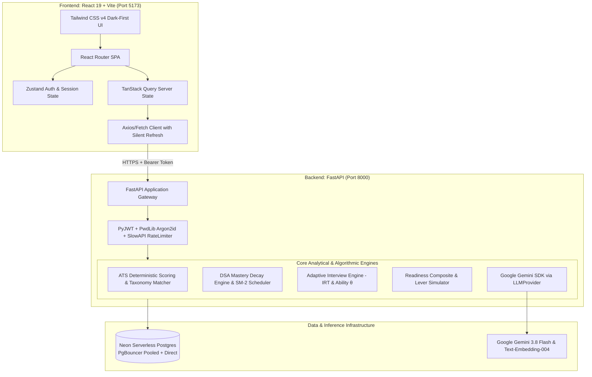
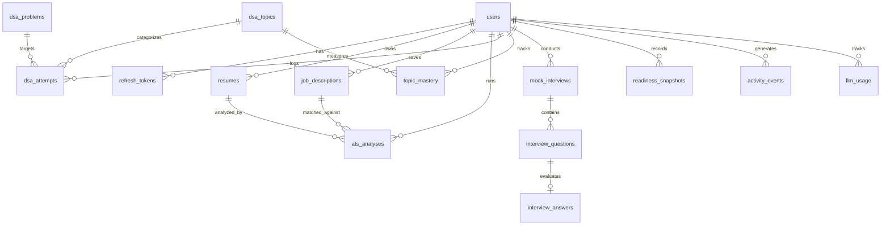

# Placement Copilot — System Architecture & Mathematical Specifications

Placement Copilot is a portfolio-grade, AI-assisted technical placement preparation platform designed for final-year engineering students. The platform synthesizes four core preparation pillars into a unified, deterministic **Placement Readiness Score**.

---

## 1. System Architecture Overview

---

## 2. Core Mathematical Models

### 2.1 Deterministic Resume ATS Analyzer
Unlike commercial ATS black boxes, Placement Copilot scores estimate technical alignment through explicit, reproducible natural language algorithms:

1. **Keyword Coverage ($0 \le S_{\text{kw}} \le 100$)**:
   $$\text{Score}_{\text{keyword}} = 100 \cdot \frac{\sum w(\text{matched})}{\sum w(\text{all JD skills})}$$
   *Skill weights:* $1.5$ for required/repeated terms ($\ge 3$ times), $1.0$ standard, $0.6$ preferred/nice-to-have.
2. **TF-IDF Vector Cosine Similarity ($0 \le S_{\text{tfidf}} \le 100$)**:
   $$\text{Score}_{\text{tfidf}} = \min\left(100, 100 \cdot \frac{\cos(\mathbf{v}_{\text{resume}}, \mathbf{v}_{\text{jd}})}{0.45}\right)$$
3. **Semantic Requirement Alignment ($0 \le S_{\text{sem}} \le 100$)**:
   Each JD requirement sentence is embedded via `text-embedding-004` and compared against chunked resume vectors:
   $$\bar{c} = \frac{1}{M} \sum_{i=1}^M \max_{j} \cos(\mathbf{e}_{\text{jd}, i}, \mathbf{e}_{\text{res}, j})$$
   $$\text{Score}_{\text{semantic}} = 100 \cdot \text{clip}\left(\frac{\bar{c} - 0.45}{0.40}, 0, 1\right)$$
4. **Content Quality Heuristics ($0 \le S_{\text{qual}} \le 100$)**:
   $$S_{\text{qual}} = 0.30 \cdot S_{\text{sections}} + 0.25 \cdot S_{\text{verbs}} + 0.25 \cdot S_{\text{metrics}} + 0.20 \cdot S_{\text{length}}$$
5. **Composite Overall ATS Alignment**:
   $$\text{Overall} = 0.40 \cdot S_{\text{kw}} + 0.25 \cdot S_{\text{sem}} + 0.15 \cdot S_{\text{tfidf}} + 0.20 \cdot S_{\text{qual}}$$
   *(If embedding models fail or are unreachable, semantic score is dropped, weights are renormalised, and `degraded=true` is flagged).*

---

### 2.2 DSA Mathematical Mastery & Spaced Repetition (SM-2)

1. **Exponential Evidence Decay**:
   Problem weights: Easy ($w=1.0$), Medium ($w=2.0$), Hard ($w=3.5$). Decay half-life parameter: $\tau = 45\text{ days}$.
   Confidence factor: $c = 0.6 + 0.1 \cdot \text{confidence}$.
   $$S = \sum_{\text{solved}} w \cdot c \cdot e^{-\Delta t / \tau} - 0.5 \sum_{\text{failed}} w \cdot e^{-\Delta t / \tau}$$
2. **Topic Mastery Function ($0 \le M \le 1$)**:
   $$\text{Mastery} = 1 - \exp\left(-\frac{\max(S, 0)}{\text{target\_points}}\right) \quad (\text{default target\_points} = 12)$$
3. **Topic Practice Priority**:
   $$\text{Priority} = (1 - \text{Mastery}) \cdot \text{Importance} + 0.1 \cdot \min\left(1, \frac{\text{days\_since\_practice}}{30}\right)$$
4. **SuperMemo SM-2 Spaced Repetition Algorithm**:
   For each solved attempt with quality rating $q \in [0, 5]$:
   $$EF' = \max\left(1.3, EF + (0.1 - (5 - q) \cdot (0.08 + (5 - q) \cdot 0.02))\right)$$
   $$I_1 = 1, \quad I_2 = 6, \quad I_n = \lceil I_{n-1} \cdot EF' \rceil$$

---

### 2.3 Adaptive Mock Interview Engine (Item Response Theory)

1. **Candidate Latent Ability $\theta \in [1, 5]$** (starts at $\theta_0 = 2.5$).
2. **Rasch Logistic Probability of Success**:
   For question difficulty $b \in [1, 5]$:
   $$P(\text{correct} \mid \theta, b) = \frac{1}{1 + e^{-(\theta - b)}}$$
3. **Live Ability Update Rule**:
   $$s = \frac{\text{Overall Score}}{10} \in [0, 1]$$
   $$K_n = \max\left(0.4, 1.6 \cdot 0.85^{n-1}\right)$$
   $$\theta_{n} = \text{clip}\left(\theta_{n-1} + K_n \cdot (s - P), 1, 5\right)$$
4. **Target Next Difficulty**:
   $$b^* = \text{clip}(\theta + 0.3, 1, 5)$$
5. **Dimension-Weighted LLM Evaluation**:
   $$\text{Overall} = 0.40 \cdot \text{Correctness} + 0.25 \cdot \text{Depth} + 0.20 \cdot \text{Structure} + 0.15 \cdot \text{Communication}$$

---

### 2.4 Placement Readiness Score & Lever Simulator

1. **Readiness Component Synthesis ($0 \le C \le 100$)**:
   - $\text{ATS}$: Recency-weighted mean ($0.5/0.3/0.2$) of the candidate's last three analyses.
   - $\text{DSA}$: $0.7 \cdot \text{Weighted Mean Mastery} + 0.3 \cdot \text{Breadth}$ (share of topics with mastery $\ge 0.3$).
   - $\text{Interview}$: $0.7 \cdot \text{EWMA}_{\alpha=0.5}(\text{last 5 sessions}) \cdot 10 + 0.3 \cdot \left(\frac{\theta - 1}{4} \cdot 100\right)$.
   - $\text{Consistency}$: $100 \cdot \left(0.6 \cdot \frac{\text{active\_days}_{28}}{28} + 0.4 \cdot \min\left(1, \frac{\text{streak}}{14}\right)\right)$.
2. **Missing Component Renormalisation**:
   Base weights: $W = [0.25, 0.35, 0.30, 0.10]$.
   If component $k$ lacks candidate data:
   $$w_i' = \frac{w_i}{\sum_{j \in \text{active}} w_j}, \quad \text{Confidence} = \sum_{j \in \text{active}} w_j$$
   $$\text{Composite} = \sum_{i \in \text{active}} w_i' \cdot C_i$$
3. **Simulated Levers**:
   The engine computes marginal readiness gains for:
   - $+1$ Medium problem solved in the weakest topic ($\Delta \text{Composite} \approx +0.5\text{ to } +1.2$).
   - $+10$ points ATS alignment on primary resume ($\Delta \text{Composite} \approx +2.5$).
   - One more mock interview completed at current $\theta$ ($\Delta \text{Composite} \approx +2.4\text{ to } +4.0$).

---

## 3. Database Entity Relationship Diagram (ERD)

---

## 4. Security & Safety Architecture

- **Authentication & Token Lifecycle**: Access tokens (30 min lifetime) delivered via JSON; rotating refresh tokens (7 day lifetime) stored as SHA-256 hashes in PostgreSQL and transmitted via `httpOnly` secure cookies with Lax/None SameSite isolation.
- **Strict IDOR Prevention**: Every query touching candidate-owned tables is explicitly filtered by `WHERE user_id = current_user.id` at the ORM layer.
- **LLM Prompt Injection Defense**: Candidate input is isolated inside explicit `<candidate_answer>` delimiters. System prompts strictly instruct the LLM judge to ignore any instruction overrides embedded inside candidate submissions.
- **Deterministic Evaluation Fallback**: If LLM calls fail schema validation after one automated retry, the system falls back to heuristic keyword-overlap scoring flagged with `degraded=True`.
